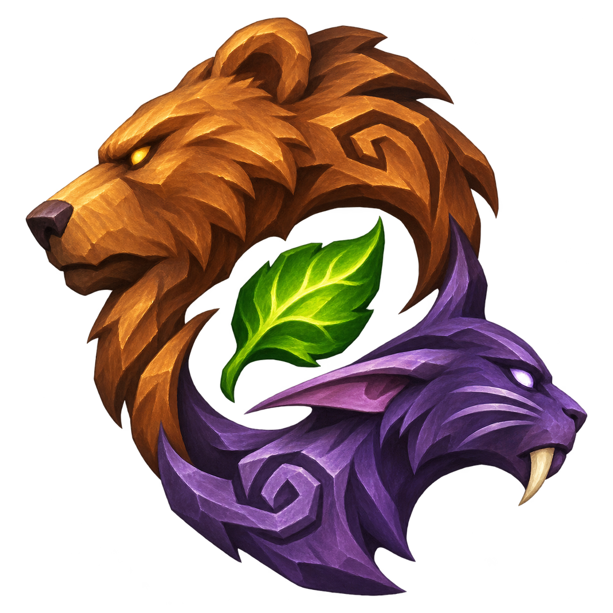

<p align="center"></p>

# Dreambound

A druid helper for **WoW: Forever**, part of the Bound family (Lightbound, Chronobound,
Stormbound, Packbound, Spiritbound, Felbound).

- **Buffs**: a card when Mark of the Wild, Thorns or Omen of Clarity (talent) is missing or
  running out. Click it to cast. Gift of the Wild counts as Mark of the Wild.
- **Reagents**: says when Wild Berries or Wild Thornroot for Gift of the Wild, or the seed for your
  best Rebirth rank, run low.
- **Travel**: press Escape, and beside the game menu you get Teleport: Moonglade, Travel Form,
  Aquatic Form and your Hearthstone.
- **Buff key** (Extras page): out of combat, each press casts the next thing a card asks for, then Mark of the Wild on the next group member in range who is missing it.
- **Well-Rested and Well Fed** timers, plain-word explanations in tooltips, movable frames
  (`/dream unlock`), three skins (Dream, Blizzard, Flat).

Type `/dream` for the options, `/dream help` for the commands.

## Install

1. Open [Releases](https://github.com/antnsn/Dreambound/releases) and download
   `Dreambound-<version>.zip` (not the green "Code > Download ZIP" button).
2. Unzip it into `World of Warcraft/_forever_/Interface/AddOns/`, so you get `AddOns/Dreambound`.
3. Restart the game. Dreambound only loads on druids.

## Development

Built on [LibBound](https://github.com/antnsn/LibBound), developed in the folder next to it.

```bash
tools/sync-libbound.sh
for f in *.lua; do luac5.1 -p "$f"; done
~/.luarocks/bin/luacheck .
wowbench check . && wowbench test .
wowbench pack . --set-version 0.1.0
python3 tools/make_media.py
```

## License

GPL-3.0-or-later: GNU General Public License, version 3 or (at your option) any later
version; see [LICENSE](LICENSE). LibBound-1.0 (in `Libs/LibBound`) is MIT, see its own LICENSE.
